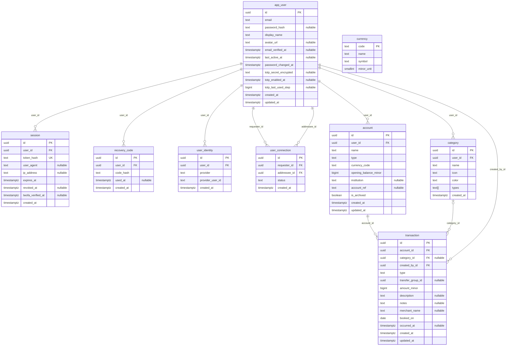

# Implemented database schema

[Back to project README](../README.md#database-schema)

This describes the nine tables defined in [schema.ts](../backend/srcs/db/schema.ts); no planned tables or fields are included.
The README has a shorter overview; this diagram lists every implemented column.

## Keys and rules

| Rule | Implementation |
|---|---|
| Primary keys | PostgreSQL-generated UUIDs, except `currency.code`, which is text. |
| Unique email | Unique index on `lower(app_user.email)`. |
| Unique sessions | `session.token_hash` is unique; raw session tokens are not stored. |
| Recovery codes | Unique `(user_id, code_hash)`; hashes only, with `used_at` recording use. |
| External identities | Unique `(provider, provider_user_id)` and `(user_id, provider)`. |
| Friend requests | Unique unordered requester/addressee pair; users must differ; status is `pending` or `accepted`. |
| Categories | Name is unique per user; the application validates a nonempty `types` subset of expense/income. |
| Transaction checks | Amount is nonzero; expense negative, income positive, transfer either; transfer group is present exactly for transfers. |
| Deletion | All foreign keys cascade on deletion except `transaction.category_id`, which is set to NULL. |
| Currency | Independent reference table with no foreign keys; accounts accept three uppercase letters, validated by the application. |
| Transfers | Entries share a UUID in `transfer_group_id`; there is no transfer table or foreign key for the group. |
| Data types | `timestamptz` means timestamp with time zone; `text[]` is an array of text values; money uses `bigint` minor units checked as safe integers by the application. |
| Enum-like values | Stored as text; allowed values are checked by the application and, for friend status and transaction type/sign, by database constraints. |
